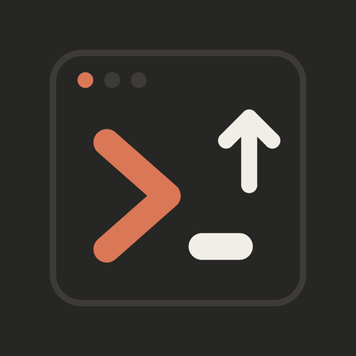
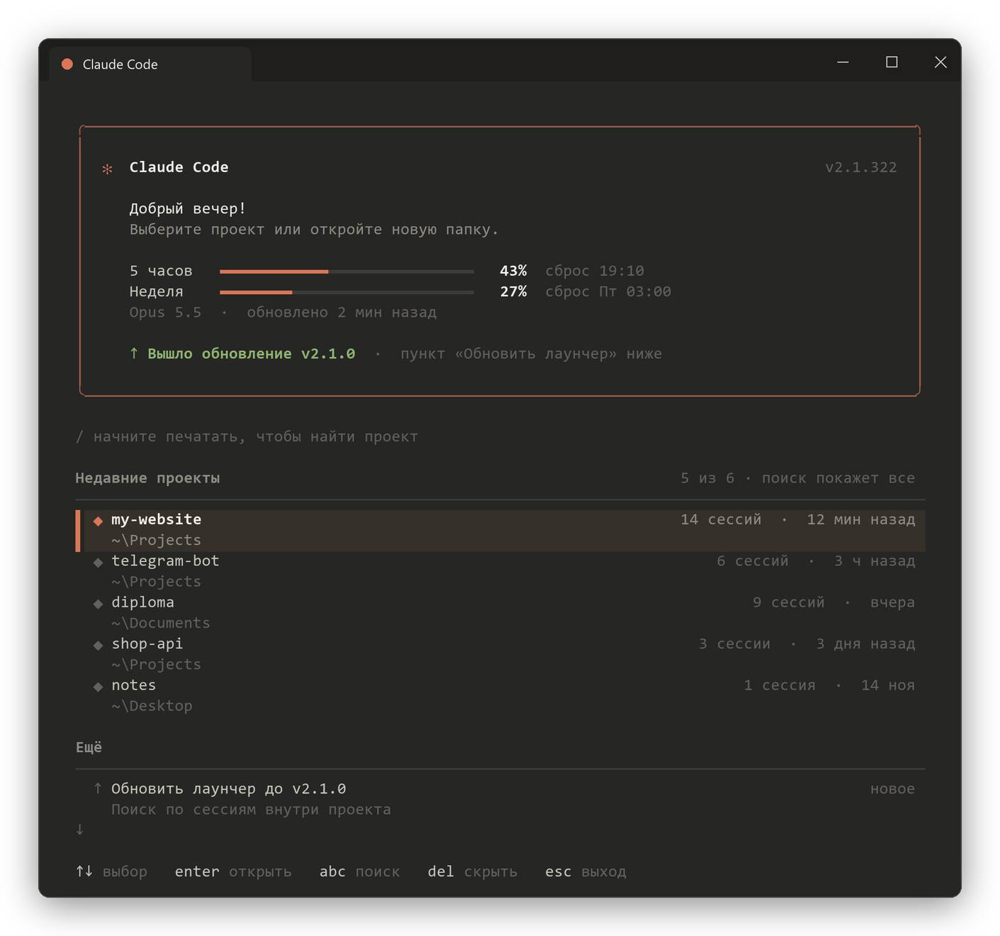
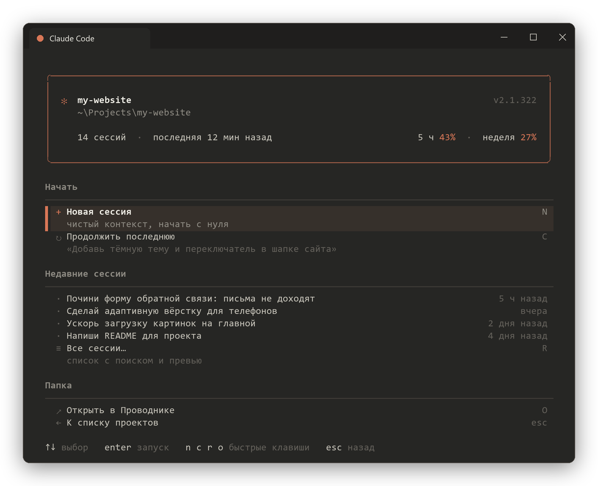
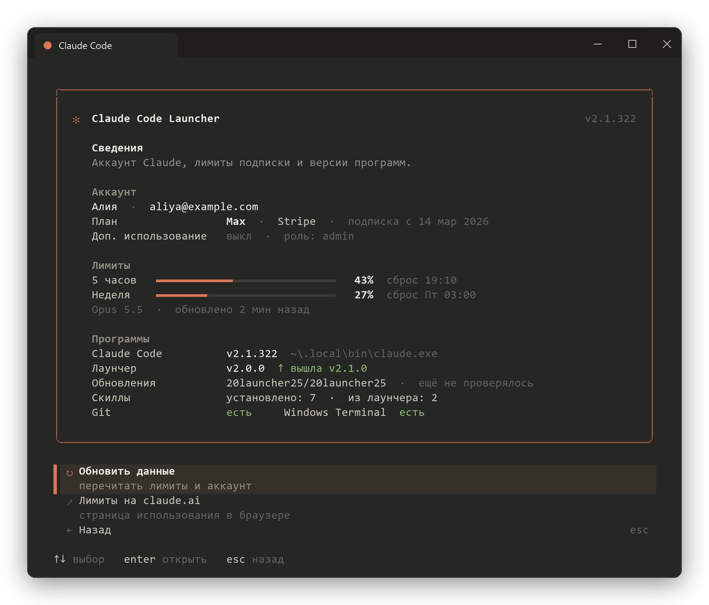
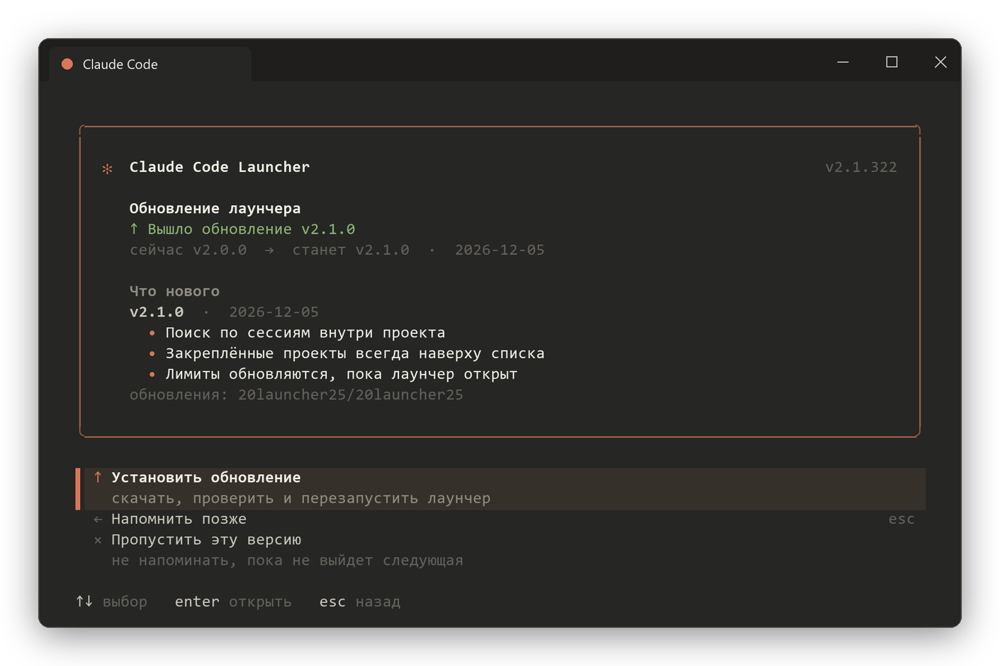
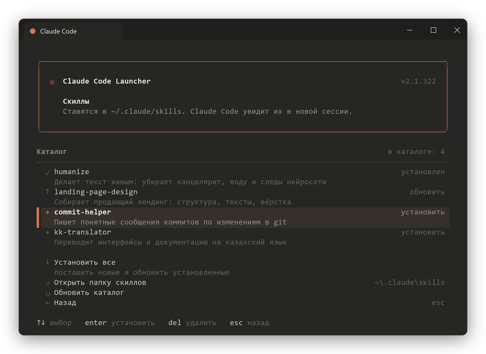
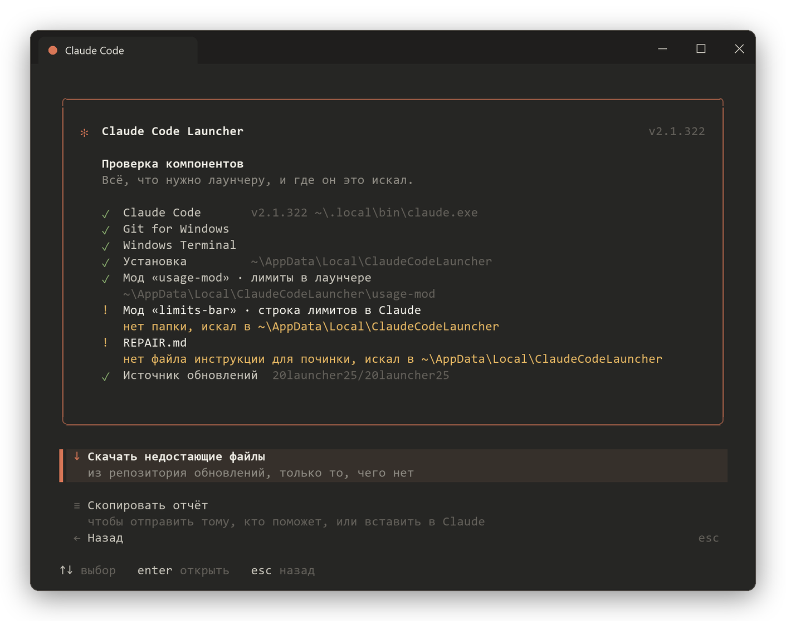
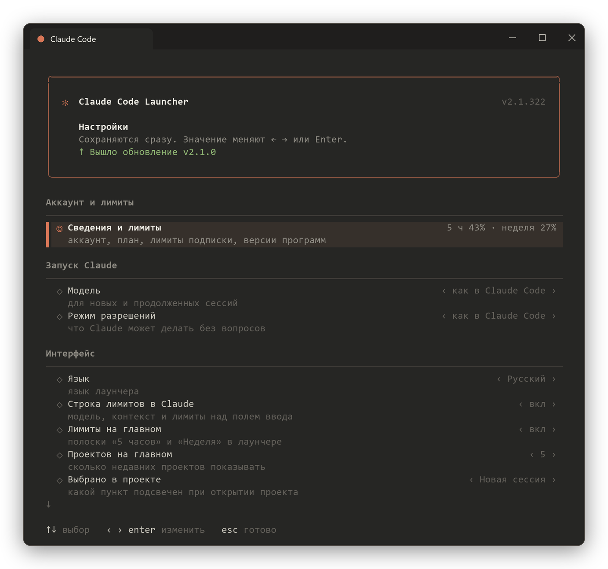

<p align="center">
  
</p>

<h1 align="center">Claude Code Launcher</h1>

<p align="center">
  A friendly menu for starting Claude Code on Windows.<br>
  Projects, sessions, subscription limits, skills and updates in one window.
</p>

<p align="center">
  <a href="README.md">Русский</a> · <a href="README.kk.md">Қазақша</a> · <b>English</b>
</p>

<p align="center">
  
  
  
</p>

<p align="center">
  
</p>

> The screenshots show the Russian interface. The launcher also speaks English: Settings → Language.

## Features

**Projects and sessions.** The launcher finds the folders where you worked with Claude Code and lists them. Start typing to filter. Inside a project you can start a new session, continue the last one or reopen any earlier one.

<p align="center"></p>

**Limits and account.** The "5 hours" and "Week" bars sit right on the home screen, and inside Claude a line above the prompt shows the model, context and limits. The Info screen collects your account, plan and program versions.

<p align="center"></p>

**One-click updates.** When a new version is out, the launcher tells you and shows what changed. Every file is checked against its checksum, so a damaged update never gets installed. The launcher watches for new Claude Code versions too: it shows what changed and updates with one button.

<p align="center"></p>

**Skill catalog.** Skills from this repository install into `~/.claude/skills` with one key, and you can update or remove them. Claude Code picks up a new skill in the next session.

<p align="center"></p>

**Clear errors.** If something is missing on the computer, the launcher says so. The component check shows what was not found, where it looked and how to fix it. It can download missing files itself and copy a report for whoever helps you.

<p align="center"></p>

<details>
<summary><b>Settings</b></summary>
<br>
Model, permission mode, language (Russian or English), how many projects to show, update checks, update source, repair with Claude and uninstall. Everything is saved instantly.
<p align="center"></p>
</details>

## Install

1. Download the archive: **[Download ZIP](https://github.com/20launcher25/20launcher25/archive/refs/heads/main.zip)**.
2. Unpack all of it into any folder.
3. Double-click **`Install.cmd`**.
4. A **Claude Code Launcher** shortcut appears on the desktop and in the Start menu.

If Windows asks whether to run the file, click "More info", then "Run anyway". This happens with any file downloaded from the internet.

**Requirements:** Windows 10 or 11, [Claude Code](https://docs.claude.com/en/docs/claude-code/setup) and [Git for Windows](https://git-scm.com/downloads/win). If Claude Code is not installed yet, the launcher offers to install it. It looks best in Windows Terminal, which comes with Windows 11.

After that the launcher updates itself, so there is no need to download the archive again.

## Controls

| Key | Action |
| :-- | :-- |
| `↑` `↓` | select an item |
| `Enter` | open or start |
| letters | search projects on the home screen |
| `N` `C` `R` `O` | in a project: new session, continue, all sessions, open folder |
| `←` `→` | in settings: change a value |
| `Delete` | hide a project or remove a skill |
| `Esc` | back |

The mouse works too: click an item to open it, scroll with the wheel.

## If something does not work

1. Open **Settings → Component check**. It shows what is missing and has buttons to fix it.
2. Still stuck? Run **`Repair.cmd`**. Claude Code opens with the [REPAIR.md](REPAIR.md) instructions, finds the cause and fixes it.
3. Or open an [issue](https://github.com/20launcher25/20launcher25/issues) and attach the report from the component check.

## Privacy

The launcher runs on your computer and sends nothing about you. Its only network traffic goes to this repository, for updates and skills. Details are in the [usage policy](POLICY.en.md).

## Contributing

- **Propose a change.** Fork the repository and open a pull request. It reaches `main` after a maintainer approves it.
- **Add a skill.** Add a `skills/<name>/SKILL.md` folder as described in [skills/README.md](skills/README.md).
- **Release a version.** Bump `$AppVersion` in `launcher.ps1`, add an entry to `changelog.json` and rebuild the manifest:
  ```powershell
  powershell -NoProfile -ExecutionPolicy Bypass -File tools\Make-Manifest.ps1
  ```

---

<sub>Claude Code Launcher is an unofficial project and is not affiliated with Anthropic. "Claude" and "Claude Code" belong to Anthropic. Terms: [POLICY.en.md](POLICY.en.md).</sub>
