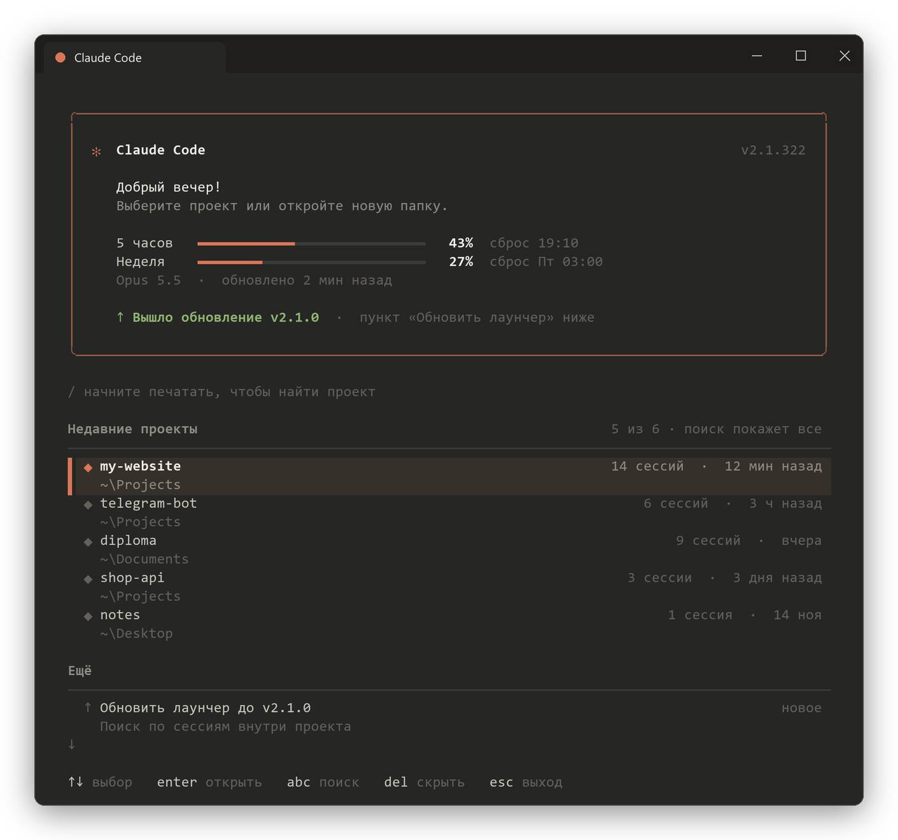
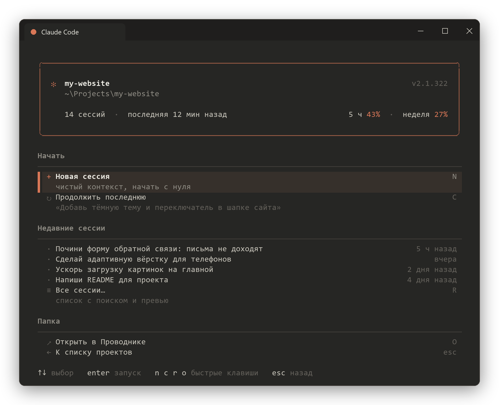
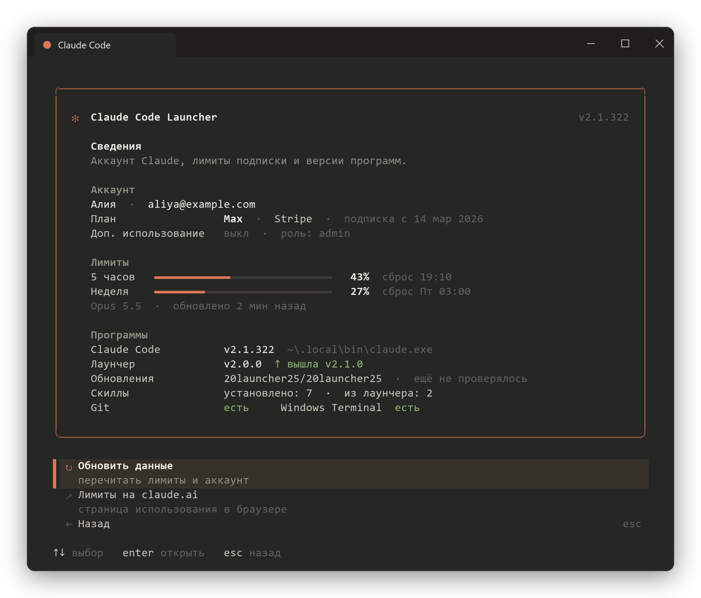
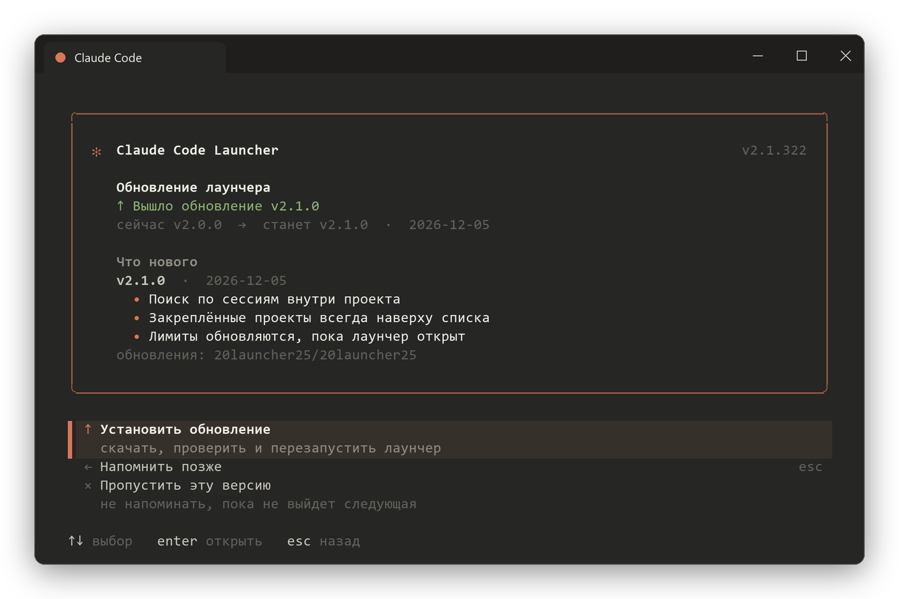
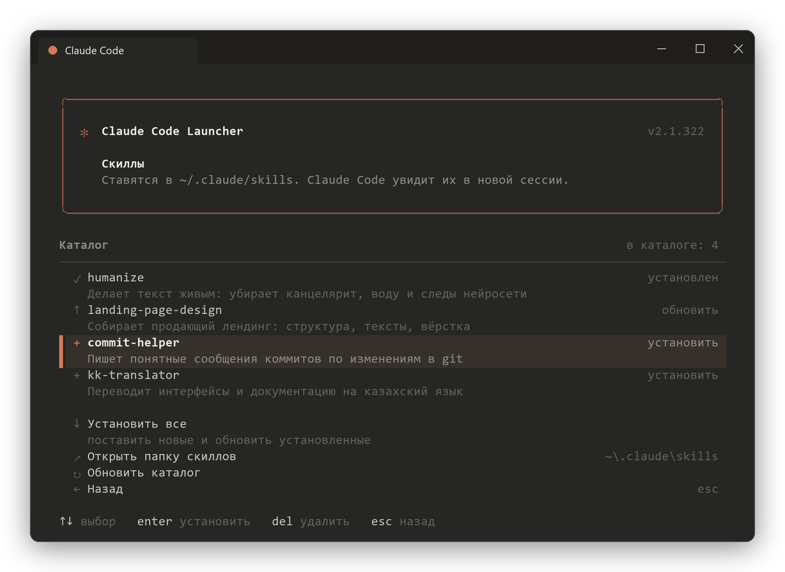
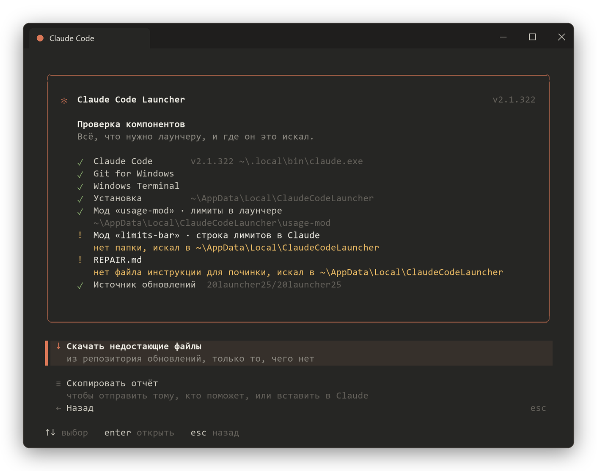
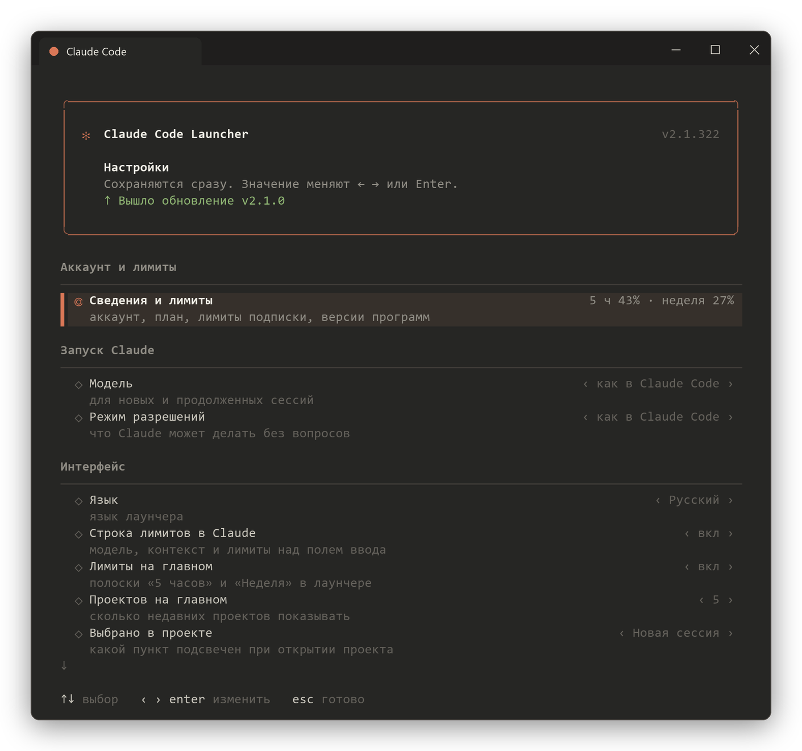

<p align="center">
  
</p>

<h1 align="center">Claude Code Launcher</h1>

<p align="center">
  Windows жүйесінде Claude Code-ты ыңғайлы іске қосуға арналған мәзір.<br>
  Жобалар, сессиялар, жазылым лимиттері, скиллдер мен жаңартулар бір терезеде.
</p>

<p align="center">
  <a href="README.md">Русский</a> · <b>Қазақша</b> · <a href="README.en.md">English</a>
</p>

<p align="center">
  
  
  
</p>

<p align="center">
  
</p>

> Скриншоттардағы интерфейс орыс тілінде. Лаунчер қазір орыс және ағылшын тілдерінде жұмыс істейді.

## Не істей алады

**Жобалар мен сессиялар.** Лаунчер Claude Code-пен жұмыс істеген қалталарыңызды өзі тауып, тізіммен көрсетеді. Теріп бастасаңыз, тек керектілері қалады. Жобаның ішінде жаңа сессия бастауға, соңғысын жалғастыруға немесе бұрынғылардың кез келгенін ашуға болады.

<p align="center"></p>

**Лимиттер мен аккаунт.** «5 сағат» және «Апта» жолақтары басты экранда бірден көрінеді, ал Claude ішінде енгізу өрісінің үстінде модель, контекст пен лимиттер жазылған жол бар. «Мәліметтер» бөлімінде аккаунт, жазылым жоспары және бағдарлама нұсқалары жиналған.

<p align="center"></p>

**Бір басумен жаңарту.** Жаңа нұсқа шыққанда лаунчер бұл туралы өзі айтып, не өзгергенін көрсетеді. Әр файл бақылау сомасы бойынша тексеріледі, сондықтан бүлінген жаңарту орнатылмайды. Лаунчер Claude Code-тың жаңа нұсқаларын да бақылайды: не өзгергенін көрсетіп, бір батырмамен жаңартады.

<p align="center"></p>

**Скиллдер каталогы.** Осы репозиторийдегі скиллдер `~/.claude/skills` қалтасына бір пернемен орнатылады, оларды жаңартуға және өшіруге болады. Claude Code жаңа скиллді келесі сессияда көреді.

<p align="center"></p>

**Түсінікті қателер.** Компьютерде бірдеңе жетіспесе, лаунчер үндемей қалмайды. «Компоненттерді тексеру» нені таппағанын, оны қайдан іздегенін және қалай түзетуге болатынын көрсетеді. Жетіспейтін файлдарды өзі жүктей алады, ал есепті көмектесетін адамға жіберу үшін көшіріп береді.

<p align="center"></p>

<details>
<summary><b>Баптаулар</b></summary>
<br>
Модель, рұқсат режимі, тіл (орысша немесе English), қанша жоба көрсету керегі, жаңартуларды тексеру, жаңарту көзі, Claude көмегімен жөндеу және жою. Барлығы бірден сақталады.
<p align="center"></p>
</details>

## Орнату

1. Мұрағатты жүктеңіз: **[Download ZIP](https://github.com/20launcher25/20launcher25/archive/refs/heads/main.zip)**.
2. Оны толығымен кез келген қалтаға ашыңыз.
3. **`Install.cmd`** файлын екі рет басыңыз.
4. Жұмыс үстелінде және «Бастау» мәзірінде **Claude Code Launcher** белгішесі пайда болады.

Егер Windows «Бұл файлды іске қосу керек пе?» деп сұраса, «Толығырақ», содан кейін «Бәрібір іске қосу» батырмасын басыңыз. Интернеттен жүктелген барлық файлдарда осылай болады.

**Не қажет:** Windows 10 немесе 11, [Claude Code](https://docs.claude.com/en/docs/claude-code/setup) және [Git for Windows](https://git-scm.com/downloads/win). Claude Code әлі орнатылмаған болса, лаунчер оны өзі орнатуды ұсынады. Ең әдемі көрінісі Windows Terminal-да, ол Windows 11-де бар.

Әрі қарай лаунчер өзі жаңарады, мұрағатты қайта жүктеудің қажеті жоқ.

## Басқару

| Перне | Әрекет |
| :-- | :-- |
| `↑` `↓` | тармақты таңдау |
| `Enter` | ашу немесе іске қосу |
| әріптер | басты экранда жобаны іздеу |
| `N` `C` `R` `O` | жобада: жаңа сессия, жалғастыру, барлық сессиялар, қалтаны ашу |
| `←` `→` | баптауларда: мәнді өзгерту |
| `Delete` | жобаны тізімнен жасыру немесе скиллді өшіру |
| `Esc` | артқа |

Тінтуірмен де болады: басу тармақты ашады, дөңгелек тізімді айналдырады.

## Бірдеңе жұмыс істемесе

1. **«Баптаулар → Компоненттерді тексеру»** бөлімін ашыңыз. Онда не жетіспейтіні көрінеді және түзетуге арналған батырмалар бар.
2. Көмектеспеді ме? **`Repair.cmd`** файлын іске қосыңыз: [REPAIR.md](REPAIR.md) нұсқаулығымен Claude Code ашылып, себебін өзі тауып жөндейді.
3. Немесе [Issues](https://github.com/20launcher25/20launcher25/issues) бөліміне жазып, «Компоненттерді тексеру» есебін қосыңыз.

## Құпиялылық

Лаунчер сіздің компьютеріңізде жұмыс істейді және сіз туралы ешнәрсе жібермейді. Интернетке тек осы жерге, жаңартулар мен скиллдер үшін ғана жүгінеді. Толығырақ [пайдалану саясатында](POLICY.kk.md).

## Қатысушыларға

- **Өзгеріс ұсыну.** Fork жасап, pull request ашыңыз. Ол `main` тармағына сүйемелдеуші мақұлдағаннан кейін түседі.
- **Скилл қосу.** [skills/README.md](skills/README.md) сипаттамасы бойынша `skills/<атауы>/SKILL.md` қалтасын қосыңыз.
- **Нұсқа шығару.** `launcher.ps1` ішіндегі `$AppVersion` мәнін көтеріп, `changelog.json` файлына жазба қосыңыз да, манифестті қайта жинаңыз:
  ```powershell
  powershell -NoProfile -ExecutionPolicy Bypass -File tools\Make-Manifest.ps1
  ```

---

<sub>Claude Code Launcher ресми емес жоба, Anthropic компаниясымен байланысы жоқ. «Claude» және «Claude Code» Anthropic компаниясына тиесілі. Шарттар: [POLICY.kk.md](POLICY.kk.md).</sub>
