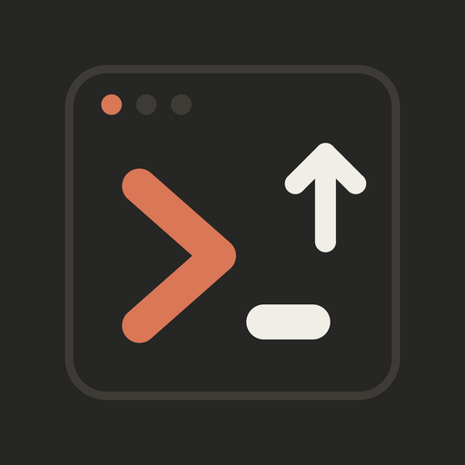
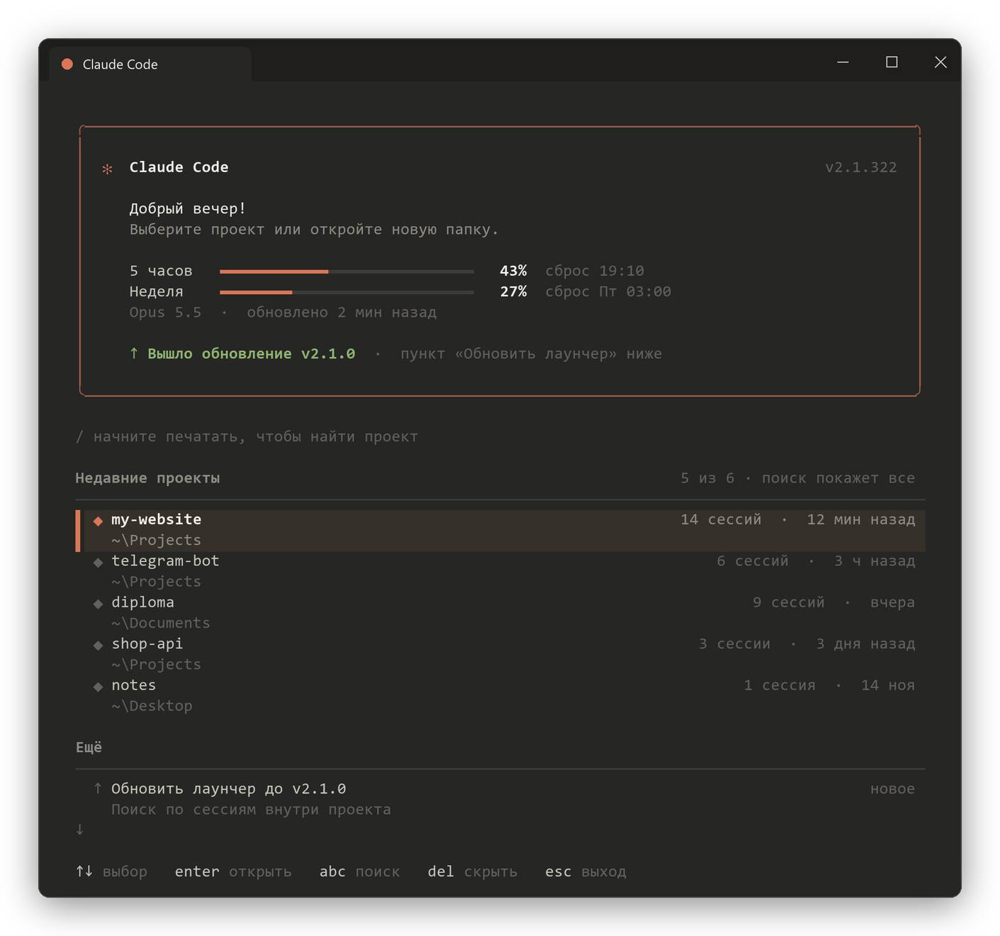
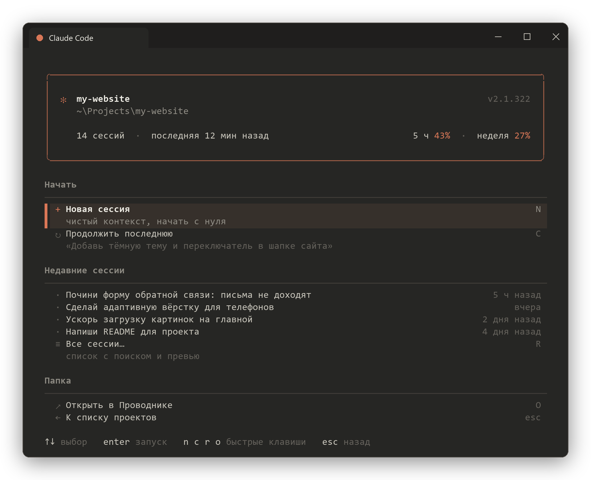
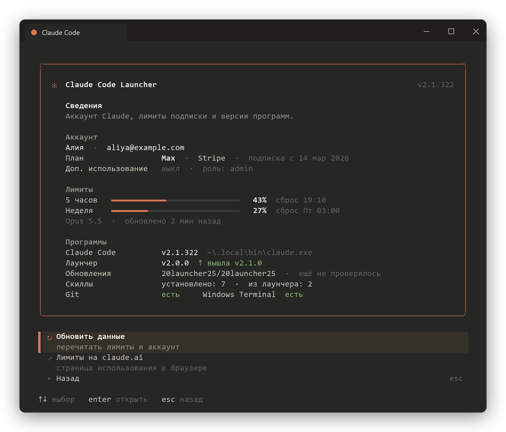
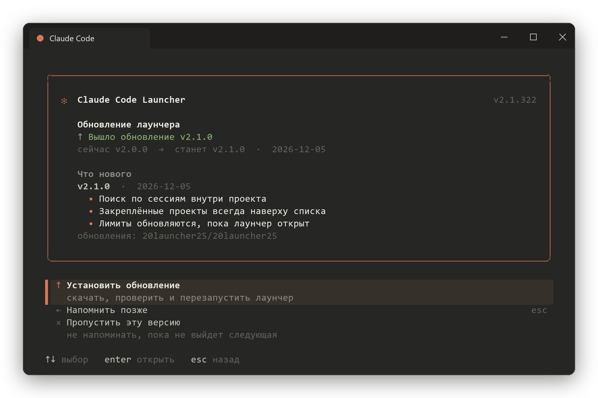
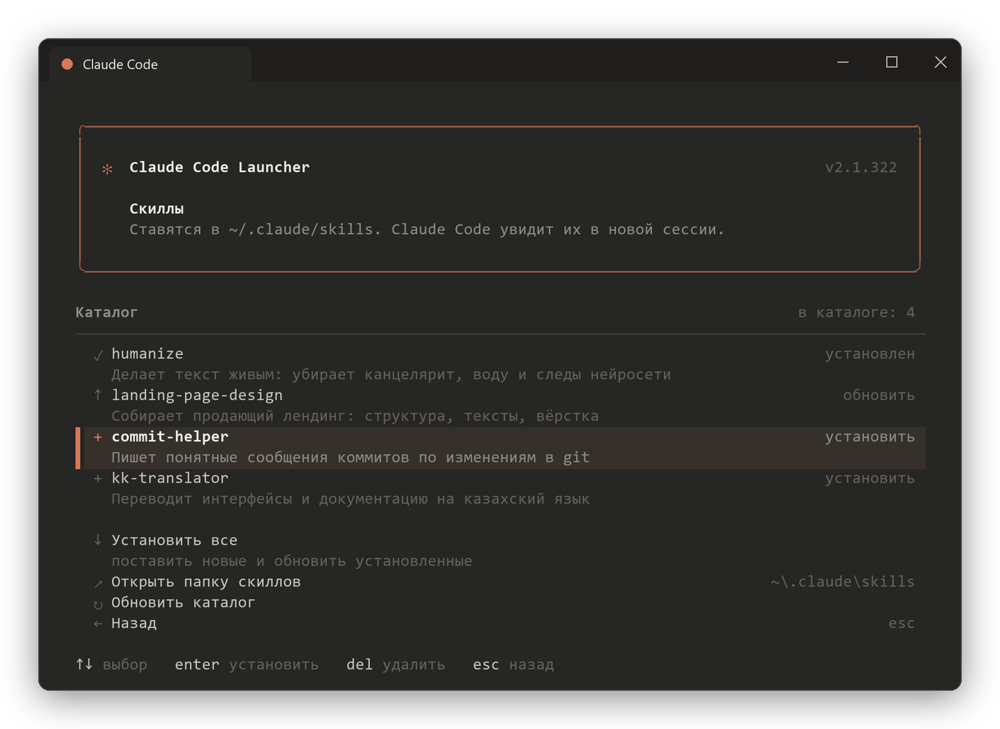
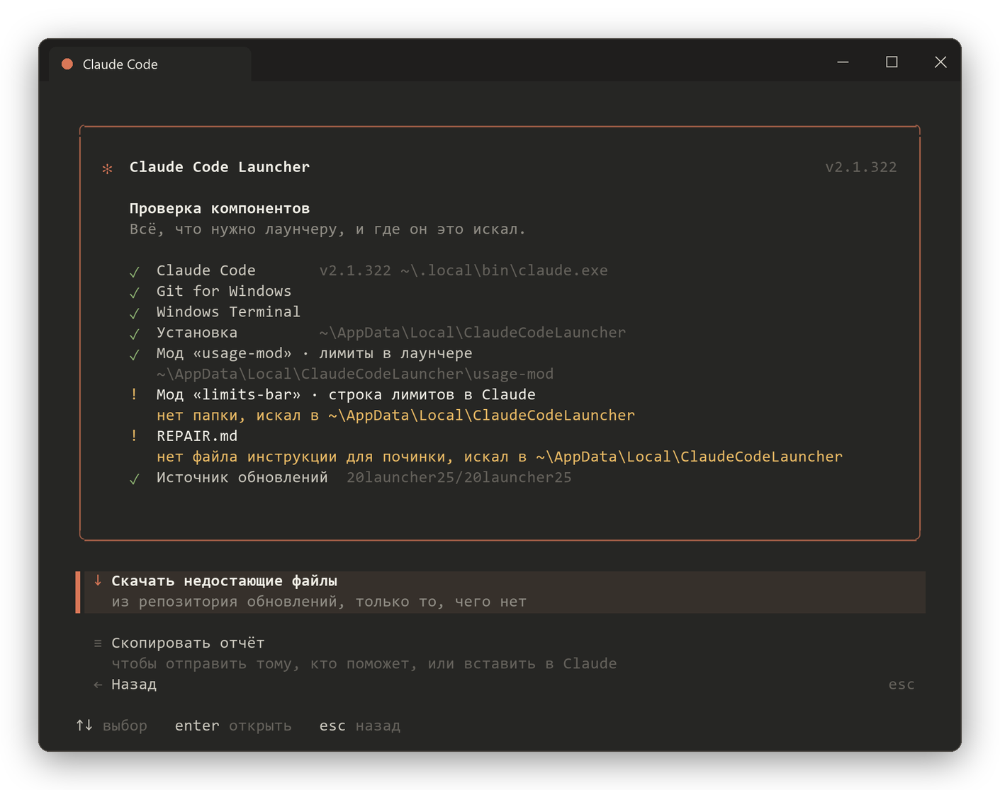
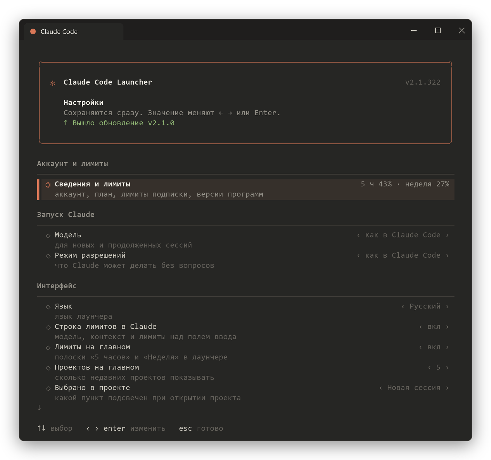

<p align="center">
  
</p>

<h1 align="center">Claude Code Launcher</h1>

<p align="center">
  Удобное меню для запуска Claude Code в Windows.<br>
  Проекты, сессии, лимиты подписки, скиллы и обновления в одном окне.
</p>

<p align="center">
  <b>Русский</b> · <a href="README.kk.md">Қазақша</a> · <a href="README.en.md">English</a>
</p>

<p align="center">
  
  
  
</p>

<p align="center">
  
</p>

## Что умеет

**Проекты и сессии.** Лаунчер сам находит папки, где вы работали с Claude Code, и показывает их списком. Начните печатать, и останутся только нужные. Внутри проекта можно начать новую сессию, продолжить последнюю или открыть любую из прошлых.

<p align="center"></p>

**Лимиты и аккаунт.** Полоски «5 часов» и «Неделя» видны сразу на главном экране, а в Claude над полем ввода есть строка с моделью, контекстом и лимитами. В «Сведениях» собраны аккаунт, план подписки и версии программ.

<p align="center"></p>

**Обновления в один щелчок.** Когда выходит новая версия, лаунчер говорит об этом сам и показывает, что изменилось. Каждый файл сверяется по контрольной сумме, поэтому повреждённое обновление не установится. За новыми версиями самого Claude Code лаунчер тоже следит: покажет, что изменилось, и обновит одной кнопкой.

<p align="center"></p>

**Каталог скиллов.** Скиллы из этого репозитория ставятся в `~/.claude/skills` одной клавишей, их можно обновлять и удалять. Claude Code подхватит новый скилл в следующей сессии.

<p align="center"></p>

**Понятные ошибки.** Если на компьютере чего-то не хватает, лаунчер не молчит. «Проверка компонентов» показывает, что не найдено, где он это искал и как исправить. Недостающие файлы он может скачать сам, а отчёт скопировать для того, кто поможет.

<p align="center"></p>

<details>
<summary><b>Настройки</b></summary>
<br>
Модель, режим разрешений, язык (русский или English), сколько проектов показывать, проверка обновлений, источник обновлений, починка с помощью Claude и удаление. Всё сохраняется сразу.
<p align="center"></p>
</details>

## Установка

1. Скачайте архив: **[Download ZIP](https://github.com/20launcher25/20launcher25/archive/refs/heads/main.zip)**.
2. Распакуйте его целиком в любую папку.
3. Дважды щёлкните **`Install.cmd`**.
4. На рабочем столе и в меню «Пуск» появится ярлык **Claude Code Launcher**.

Если Windows спросит «Запустить этот файл?», нажмите «Подробнее», затем «Выполнить в любом случае». Так бывает со всеми файлами из интернета.

**Что нужно:** Windows 10 или 11, [Claude Code](https://docs.claude.com/en/docs/claude-code/setup) и [Git for Windows](https://git-scm.com/downloads/win). Если Claude Code ещё не установлен, лаунчер предложит поставить его сам. Лучше всего он выглядит в Windows Terminal, который уже есть в Windows 11.

Дальше лаунчер обновляется сам, скачивать архив снова не нужно.

## Управление

| Клавиша | Действие |
| :-- | :-- |
| `↑` `↓` | выбор пункта |
| `Enter` | открыть или запустить |
| буквы | поиск проекта на главном экране |
| `N` `C` `R` `O` | в проекте: новая сессия, продолжить, все сессии, открыть папку |
| `←` `→` | в настройках: поменять значение |
| `Delete` | скрыть проект из списка или удалить скилл |
| `Esc` | назад |

Мышью тоже можно: щелчок открывает пункт, колесо листает список.

## Если что-то не работает

1. Откройте **«Настройки → Проверка компонентов»**. Там видно, чего не хватает, и есть кнопки, чтобы это исправить.
2. Не помогло? Запустите **`Repair.cmd`**: откроется Claude Code с инструкцией [REPAIR.md](REPAIR.md), он сам найдёт причину и починит.
3. Или напишите в [Issues](https://github.com/20launcher25/20launcher25/issues) и приложите отчёт из «Проверки компонентов».

## Конфиденциальность

Лаунчер работает на вашем компьютере и ничего о вас не отправляет. В интернет он ходит только сюда, за обновлениями и скиллами. Подробнее в [политике использования](POLICY.md).

## Для участников

- **Предложить изменение.** Сделайте fork и откройте pull request. В ветку `main` он попадёт после одобрения сопровождающего.
- **Добавить скилл.** Положите папку `skills/<имя>/SKILL.md`, как описано в [skills/README.md](skills/README.md).
- **Выпустить версию.** Поднимите `$AppVersion` в `launcher.ps1`, добавьте запись в `changelog.json` и пересоберите манифест:
  ```powershell
  powershell -NoProfile -ExecutionPolicy Bypass -File tools\Make-Manifest.ps1
  ```

---

<sub>Claude Code Launcher является неофициальным проектом и не связан с Anthropic. «Claude» и «Claude Code» принадлежат Anthropic. Условия: [POLICY.md](POLICY.md).</sub>
